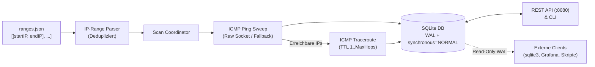

# smonitor

Ein schlanker, sicherheitsgehärteter und vollständig abhängigkeitsfreier Network Monitor & Scanner in **Go** für **Linux & Raspberry Pi**, angelehnt an [`deunderscorepaul/netmon`](https://github.com/deunderscorepaul/netmon).

Kompilierbar als **Single Static Binary (`CGO_ENABLED=0`)** ohne Python oder externe Runtime-Bibliotheken, ausgelegt für den **Least-Privilege-Betrieb** (`CAP_NET_RAW` ohne Root-Rechte) mit **SQLite (WAL-Modus)** und leichtgewichtiger **REST-API**.

---

## Inhaltsverzeichnis

1. [Überblick & Architektur](#1-überblick--architektur)
2. [Projektstruktur](#2-projektstruktur)
3. [IP-Range Konfiguration (`ranges.json`)](#3-ip-range-konfiguration-rangesjson)
4. [SQLite-Datenbankschema & externer Zugriff](#4-sqlite-datenbankschema--externer-zugriff)
5. [Kompilierung als Single Static Binary](#5-kompilierung-als-single-static-binary)
6. [Raspberry Pi / Linux-Deployment (`setcap` & `systemd`)](#6-raspberry-pi--linux-deployment-setcap--systemd)
7. [CLI-Referenz & Beispiele](#7-cli-referenz--beispiele)
8. [REST-API Überblick](#8-rest-api-überblick)
9. [Tests & Entwicklung](#9-tests--entwicklung)

---

## 1. Überblick & Architektur

`smonitor` konzentriert sich bewusst auf zuverlässiges IPv4-Monitoring ohne unnötigen Overhead:

- **Vorgegebene IP-Ranges via JSON**: Beliebig viele `[Start-IP, End-IP]`-Paare; alle dazwischenliegenden IPv4-Adressen werden berechnet und dedupliziert gescannt.
- **Nativer ICMP-Ping & Traceroute**:
  - Paralleler ICMP-Echo-Sweep mit sanftem Packet-Pacing (schont Raspberry Pi Netzwerk-Interfaces und WLAN-APs) sowie monotoner RTT-Messung.
  - Automatischer TTL-basierter ICMP-Traceroute (`1..max-hops`) für alle erreichbaren Hosts sowie gezielt per CLI/API (`--traceroute <IP>`).
  - **Raw-Sockets mit Least Privilege (`CAP_NET_RAW`)**: Unter Linux kommuniziert `smonitor` direkt über `golang.org/x/net/icmp` und `ipv4` ohne Subprozesse. Falls in unprivilegierten Testumgebungen (z. B. Windows-Entwicklung ohne Admin-Rechte) kein Raw-Socket geöffnet werden darf, greift automatisch ein transparenter Fallback auf System-`ping` / `traceroute` / `tracert`.
- **SQLite-Anbindung nach außen & Offline-Historie**:
  - Pure-Go SQLite (`modernc.org/sqlite`) im `WAL`-Modus (`synchronous=NORMAL`, `busy_timeout=5000`), sodass externe Tools parallel und sperrfrei lesen können.
  - Geht ein zuvor erreichbares Gerät offline (`is_online = 0`), wird `last_offline` gesetzt, **`last_seen` bleibt als letzter erreichbarer Zeitpunkt unverändert erhalten** und in `host_events` wird ein `OFFLINE`-Eintrag samt letztem erreichbarem Zeitstempel protokolliert.
  - Schlägt ein Traceroute bei einem bereits bekannten Host vorübergehend fehl, bleibt die zuletzt gespeicherte Route in SQLite erhalten.



---

## 2. Projektstruktur

```text
smonitor/
├── cmd/
│   └── smonitor/
│       └── main.go                  # CLI-Parsing, Daemon-Runner & Graceful Shutdown
├── docs/
│   └── API.md                       # Ausführliche REST-API- & SQLite-Referenz
├── internal/
│   ├── api/
│   │   ├── server.go                # HTTP REST API (Constant-Time Auth, CORS, Validierung)
│   │   └── server_test.go           # API-Unit-Tests
│   ├── cli/
│   │   └── table.go                 # Terminal-Tabellenausgabe (UTF-8-sichere Kürzung)
│   ├── config/
│   │   ├── ranges.go                # JSON IP-Range-Parser & Limits
│   │   └── ranges_test.go           # Range-Parser-Unit-Tests
│   ├── coordinator/
│   │   ├── coordinator.go           # Scan-Orchestrierung, Cancel-Guards, Event-Logging
│   │   └── coordinator_test.go      # Coordinator- & Offline-Übergangs-Tests
│   ├── model/
│   │   └── host.go                  # Structs: Host, Hop, HostEvent, NetworkMetrics
│   ├── scanner/
│   │   ├── scanner.go               # Engine-Interface, Payload- & ICMP-Header-Helpers
│   │   ├── icmp_raw.go              # Nativer ICMPv4 Raw-Socket Ping & Traceroute
│   │   ├── os_fallback.go           # Fallback auf OS ping / traceroute / tracert
│   │   └── scanner_test.go          # Scanner- & Parser-Unit-Tests
│   └── storage/
│       ├── sqlite.go                # Pure-Go SQLite-Storage (WAL, Transaktionen)
│       └── sqlite_test.go           # Persistenz- & Offline-Zeitstempel-Tests
├── scripts/
│   ├── smonitor.service             # Gehärtete systemd-Service-Unit (CAP_NET_RAW)
│   └── setup-linux.sh               # Automatisches Raspberry-Pi/Linux-Setup
├── ranges.example.json              # Beispiel-Konfiguration der IP-Ranges
├── Makefile                         # Cross-Compilation (ARM64, ARMv7, AMD64)
├── go.mod
└── README.md
```

---

## 3. IP-Range Konfiguration (`ranges.json`)

Die Zielbereiche werden in einer JSON-Datei als Array von jeweils zwei IPv4-Adressen (`[Start-IP, End-IP]`) definiert. `smonitor` berechnet die inklusive Differenz (`Start-IP <= IP <= End-IP`) und scannt alle dazwischenliegenden Adressen:

```json
[
  ["192.168.1.1", "192.168.1.50"],
  ["192.168.1.100", "192.168.1.120"],
  ["10.0.0.1", "10.0.0.10"]
]
```

**Besonderheiten des Parsers (`internal/config/ranges.go`):**
- **Inklusiv & über Oktett-Grenzen hinweg**: z. B. `["192.168.1.254", "192.168.2.2"]` erzeugt alle 5 Adressen.
- **Automatische Sortierung & Deduplizierung**: Vertauschte Paare (`Start > End`) werden automatisch gedreht; überlappende Ranges werden in stabiler Reihenfolge dedupliziert.
- **UTF-8 BOM-Toleranz**: Führende Byte-Order-Marks (z. B. durch Windows-Editoren oder PowerShell) werden automatisch entfernt.
- **Speicherschutz für Raspberry Pi**: Sowohl pro Range als auch über alle Ranges kombiniert gilt ein Limit von maximal `1.048.576` IPs (`1 << 20`).
- **Live-Reload im Daemon-Modus**: `ranges.json` wird zu Beginn jedes Scan-Intervalls neu eingelesen — Änderungen werden ohne Neustart des Dienstes aktiv.

---

## 4. SQLite-Datenbankschema & externer Zugriff

Die Datenbank wird mit folgenden PRAGMAs geöffnet:
`busy_timeout=5000`, `journal_mode=WAL`, `synchronous=NORMAL`, `foreign_keys=ON`.

```sql
-- Tabelle 1: Überwachte / erreichbare Geräte
CREATE TABLE IF NOT EXISTS hosts (
    ip_address TEXT PRIMARY KEY,               -- IPv4-Adresse (z. B. '192.168.1.10')
    hostname TEXT DEFAULT '',                  -- Optionaler Reverse-DNS-Name
    notes TEXT DEFAULT '',                     -- Frei wählbare Notiz / Beschreibung
    is_online INTEGER NOT NULL DEFAULT 1,      -- 1 = Erreichbar, 0 = Offline
    rtt_ms REAL NOT NULL DEFAULT 0,            -- Letzte Ping-Antwortzeit in ms
    first_seen DATETIME NOT NULL,              -- Erstmals erreichbar (UTC)
    last_seen DATETIME NOT NULL,               -- Letzter erreichbarer Zeitpunkt (UTC)
    last_offline DATETIME,                     -- Zeitpunkt, seit dem das Gerät offline ist (UTC)
    hop_count INTEGER NOT NULL DEFAULT 0,      -- Anzahl der Traceroute-Hops
    last_route TEXT NOT NULL DEFAULT '[]'      -- JSON-Array der Hops: [{ttl, ip, rtt_ms, timeout}]
);

-- Tabelle 2: Ereignisprotokoll (Statuswechsel & letzter erreichbarer Zeitpunkt)
CREATE TABLE IF NOT EXISTS host_events (
    id INTEGER PRIMARY KEY AUTOINCREMENT,
    ip_address TEXT NOT NULL,
    event_type TEXT NOT NULL,                  -- 'DISCOVERED', 'ONLINE', 'OFFLINE'
    details TEXT,                              -- z. B. 'Host unreachable (last reachable: 2026-11-25T10:40:00Z)'
    timestamp DATETIME NOT NULL,
    FOREIGN KEY(ip_address) REFERENCES hosts(ip_address) ON DELETE CASCADE
);

CREATE INDEX IF NOT EXISTS idx_hosts_is_online ON hosts(is_online);
CREATE INDEX IF NOT EXISTS idx_hosts_last_seen ON hosts(last_seen);
CREATE INDEX IF NOT EXISTS idx_host_events_timestamp ON host_events(timestamp);
CREATE INDEX IF NOT EXISTS idx_host_events_ip ON host_events(ip_address);
```

### Beispiel-Abfragen für externe Programme (WAL Read-Only)

```bash
# Offline-Geräte inklusive letztem erreichbarem Zeitpunkt abfragen
sqlite3 -readonly /var/lib/smonitor/smonitor.db \
  "SELECT ip_address, hostname, last_seen AS last_reachable, last_offline FROM hosts WHERE is_online = 0 ORDER BY last_offline DESC;"

# Letzte 20 Status-Events (ONLINE / OFFLINE) anzeigen
sqlite3 -readonly /var/lib/smonitor/smonitor.db \
  "SELECT timestamp, event_type, ip_address, details FROM host_events ORDER BY id DESC LIMIT 20;"
```

Weitere Beispiele (inklusive `json_each` zum Auswerten von `last_route`) stehen in [docs/API.md](docs/API.md).

---

## 5. Kompilierung als Single Static Binary

Dank Pure-Go SQLite (`modernc.org/sqlite`) und `golang.org/x/net` wird kein C-Compiler benötigt (`CGO_ENABLED=0`):

```bash
# Raspberry Pi 4 / 5 (64-Bit Pi OS / Linux ARM64)
make build-linux-arm64

# Raspberry Pi 2 / 3 (32-Bit Pi OS / Linux ARMv7)
make build-linux-armv7

# Standard Linux x86_64
make build-linux-amd64

# Host-OS (z. B. lokal für Tests)
make build
```

Oder direkt unter Windows PowerShell für Raspberry Pi ARM64:

```powershell
$env:CGO_ENABLED="0"; $env:GOOS="linux"; $env:GOARCH="arm64"
go build -trimpath -ldflags "-s -w -X main.version=1.0.0" -o bin/smonitor-linux-arm64 ./cmd/smonitor
```

---

## 6. Raspberry Pi / Linux-Deployment (`setcap` & `systemd`)

### Automatisches Setup (empfohlen)

1. Kopiere das kompilierte Binary (z. B. `bin/smonitor-linux-arm64`), `ranges.example.json` sowie `scripts/` auf den Raspberry Pi.
2. Starte das Setup-Skript als Root:

```bash
sudo chmod +x scripts/setup-linux.sh
sudo ./scripts/setup-linux.sh bin/smonitor-linux-arm64
```

Das Skript richtet einen unprivilegierten Systembenutzer `smonitor` ein, legt `/var/lib/smonitor` (`0750`) und `/etc/smonitor/ranges.json` (`0640`) an, installiert das Binary nach `/usr/local/bin/smonitor`, vergibt `CAP_NET_RAW` via `setcap` und installiert die gehärtete systemd-Unit `scripts/smonitor.service`.

3. Ranges anpassen und Service aktivieren:

```bash
sudo nano /etc/smonitor/ranges.json
sudo systemctl enable --now smonitor
sudo journalctl -u smonitor -f
```

### Manuelles Capability-Setup (für direkte CLI-Aufrufe ohne Root)

```bash
sudo setcap cap_net_raw+ep /usr/local/bin/smonitor
getcap /usr/local/bin/smonitor
# Ausgabe: /usr/local/bin/smonitor cap_net_raw=ep
```

---

## 7. CLI-Referenz & Beispiele

### Verfügbare Flags

| Flag | Standard | Beschreibung |
| :--- | :--- | :--- |
| `--ranges` | `ranges.json` | Pfad zur JSON-Datei mit `[startIP, endIP]`-Paaren |
| `--db` | `smonitor.db` | Pfad zur SQLite-Datenbankdatei (WAL-Modus) |
| `--scan-once` | `false` | Einmaliger Ping- & Traceroute-Scan über alle konfigurierten Ranges |
| `--daemon` | `false` | Dauerbetrieb mit periodischem Scan und REST-API |
| `--interval` | `2m` | Scan-Intervall im Daemon-Modus (muss `> 0` sein) |
| `--port` | `:8080` | Listen-Adresse der REST-API (z. B. `:8080` oder `127.0.0.1:8080`) |
| `--api-token` | `""` | Optionaler Bearer / `X-API-Key` Token für die REST-API |
| `--traceroute` | `""` | Gezielter Einzel-Traceroute zu einer IPv4-Adresse |
| `--list` | `false` | Alle gespeicherten Hosts aus der Datenbank anzeigen |
| `--events` | `false` | Die letzten 50 Statuswechsel (`DISCOVERED`, `ONLINE`, `OFFLINE`) anzeigen |
| `--set-note` | `""` | Notiz für einen Host per IPv4-Adresse setzen (kombiniert mit `--notes`) |
| `--notes` | `""` | Notiztext für `--set-note` |
| `--json` | `false` | Ausgabe im JSON-Format (für `--scan-once`, `--list`, `--events`, `--traceroute`) |
| `--timeout` | `1s` | Timeout pro ICMP-Ping bzw. Traceroute-Hop |
| `--max-hops` | `15` | Maximale TTL-Hops für Traceroute |
| `--concurrency` | `32` | Worker-Limit für den unprivilegierten OS-Fallback |
| `--version` | `false` | Version anzeigen und beenden |

### CLI-Beispiele

```bash
# Einmaliger Scan mit Tabellenausgabe
smonitor --scan-once --ranges ranges.json --db smonitor.db

# Gezielter Traceroute (speichert Route auch in DB, falls Host existiert)
smonitor --traceroute 192.168.1.1 --db smonitor.db

# Gespeicherte Geräte inkl. letztem erreichbarem Zeitpunkt abfragen
smonitor --list --db smonitor.db
smonitor --list --json --db smonitor.db

# Offline-/Online-Ereignisprotokoll anzeigen
smonitor --events --db smonitor.db

# Notiz für ein Gerät hinterlegen
smonitor --set-note 192.168.1.1 --notes "Haupt-Router" --db smonitor.db

# Daemon-Modus mit Token-Schutz starten
smonitor --daemon --ranges /etc/smonitor/ranges.json --db /var/lib/smonitor/smonitor.db --port :8080 --interval 2m --api-token "mein-geheimer-token"
```

---

## 8. REST-API Überblick

Im `--daemon`-Modus stellt `smonitor` eine schlanke JSON-REST-API (Standard `:8080`) bereit. Vollständige Payloads, Fehlercodes und `curl`-Beispiele sind in [docs/API.md](docs/API.md) dokumentiert.

| Methode | Endpunkt | Beschreibung |
| :--- | :--- | :--- |
| `GET` | `/healthz` | Health-Check (immer ohne Auth erreichbar) |
| `GET` | `/api/v1/metrics` | Gesamt-, Online-, Offline- und 24h-Neu-Zahlen sowie letzte Scan-Dauer |
| `GET` | `/api/v1/hosts` | Alle gespeicherten Hosts (Filter: `?online=true` oder `?online=false`) |
| `GET` | `/api/v1/hosts/{ip}` | Details inkl. `last_seen`, `last_offline` und `last_route` |
| `POST` | `/api/v1/hosts/{ip}/notes` | Notiz zu einer IP setzen (`{"notes": "..."}`) |
| `GET` | `/api/v1/events` | Ereignisprotokoll (`?limit=50`, maximal `1000`) |
| `POST` | `/api/v1/scan` | Sofortigen On-Demand-Scan ausführen |
| `POST` | `/api/v1/traceroute/{ip}` | Live-Traceroute zu einer IPv4-Adresse ausführen |

---

## 9. Tests & Entwicklung

```bash
go vet ./...
go test -v -count=1 ./...
```
